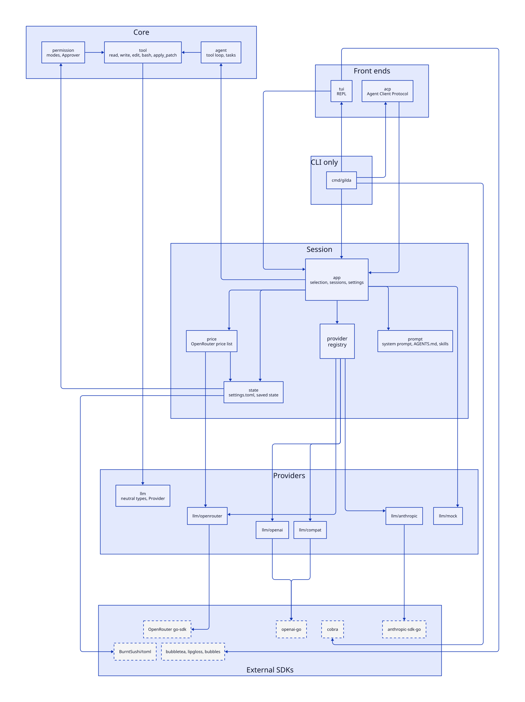
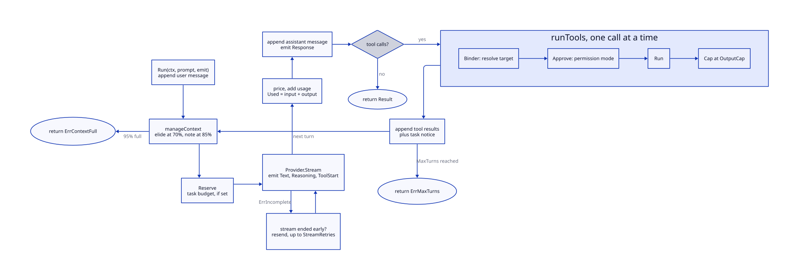
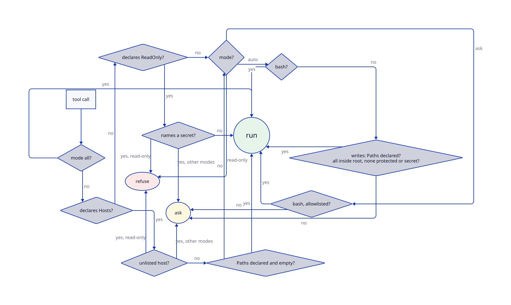
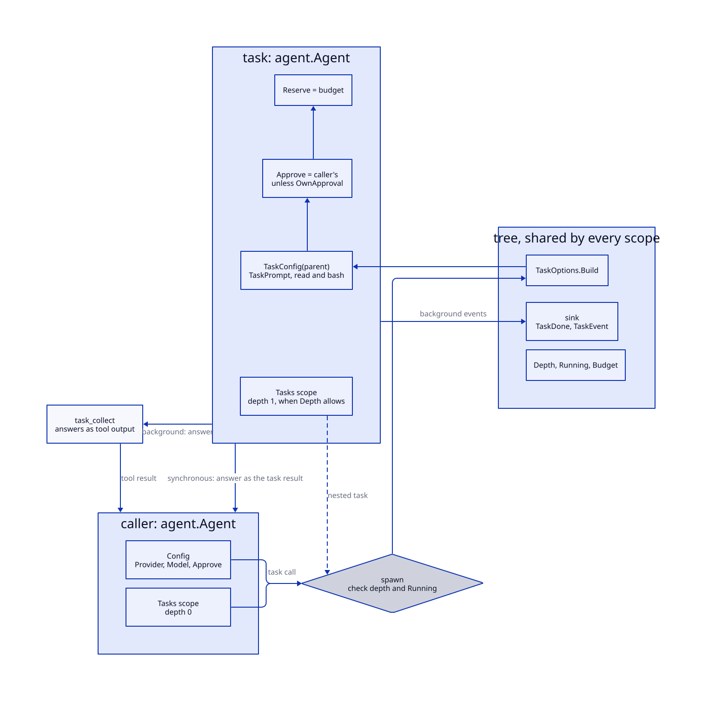

# Architecture

gilda is one Go module, `github.com/shakfu/gilda`. Every package except `cmd/gilda` is a library; the CLI is a thin layer over them. The README's [Library](../README.md#library) section documents the API for embedding apps; this page shows how the packages fit together.

## Packages

Arrows are imports. Two kinds are left out to keep the graph readable:

- Every package except `prompt` imports `llm`.
- `cmd/gilda` and `tui` also import `agent`, `permission`, `provider` and `tool` directly; `tui` also imports `price`, `prompt` and `state`.

| Layer | Packages | Role |
|-|-|-|
| Providers | `llm`, `llm/*` | `llm.Provider` and the neutral message types; one adapter per vendor SDK, plus `llm/mock` |
| Core | `agent`, `tool`, `permission` | the tool loop and its tasks, the tools, and approval by mode |
| Session | `app`, `provider`, `state`, `price`, `prompt` | provider and model selection, saved sessions, settings, prices, the system prompt |
| Front ends | `tui`, `acp`, `cmd/gilda` | the REPL, the ACP server, and the binary that picks one or runs `-p` |

Dependencies point down the table. The core imports no session or front-end package. `agent` links only `llm`, `tool` and `go-udiff`; it takes prices through the `agent.Pricer` interface rather than importing `price`. Only `tui` and `cmd/gilda` link bubbletea, lipgloss or cobra, so an app importing any other package links none of them. `examples/swarm` is such an app, in a module of its own.

## The tool loop

`agent.Run` sends the history, streams the reply, runs the calls it asks for, and repeats until the model answers without a call.

- **Context.** Before each request, `manageContext` elides old tool results past 70% of the window, warns the model once at 85%, and refuses at 95% (`agent/elide.go`).
- **Streaming.** A stream cut off mid-response left no trace in the history, so the same request is resent, up to `StreamRetries`. The SDKs retry only failed requests.
- **Tools.** Calls run one at a time, in order. Each is bound to its target (`tool.Binder`), approved (`Config.Approve`), run, and capped at `OutputCap`.
- **Usage.** A provider that reports no cost is priced by `Config.Prices`. `Used` is the last response's input plus output, so it lags one round-trip.
- **History.** `llm.Message` is provider-neutral, with each assistant message's native payload attached for replay to the same model ([`dev/design.md`](dev/design.md)).

## Permissions

`permission.Approver` turns a mode into an `Approve` function. It decides by what a tool declares, not by its name: `tool.ReadOnly`, `tool.Paths` and `tool.Hosts`. `bash` is recognised by its type. A call that needs approval goes to the app's ask function; with none, it is refused. Modes and the built-in patterns are in the README's [Permissions](../README.md#permissions) section; the sandbox design is in [`dev/permissions.md`](dev/permissions.md).

`task` declares only that it writes no files, so `read-only` mode refuses it.

## Tasks

`task` runs a subagent on a goroutine. Its scope (`agent.Tasks`) belongs to the agent that started it; all scopes of a tree share its limits, ids, token budget and event sink.

- `TaskOptions.Build` makes each task's agent, usually through `agent.TaskConfig`. `spawn` then sets the task's `Approve` to its caller's, unless `OwnApproval` is set or the caller has none, so its calls are judged as the caller's are.
- A synchronous task's answer is the `task` result. A background task's answer reaches the caller only through `task_collect`, never as user text.
- Cancelling a scope stops its subtree. A task answers only once its own tasks have.

Design and measurements: [`dev/async-tasks.md`](dev/async-tasks.md).

## Front ends

All three drive one `app.App`, so tools, modes and saved sessions behave the same in each.

| Front end | Entry | Runs prompts with | Asks through |
|-|-|-|-|
| REPL | `tui.Run` | `Agent.Run`; a task finishing while idle starts a turn | an inline prompt; approvals from tasks queue |
| `-p` | `cmd/gilda/headless.go` | `agent.Drive` | the terminal; `--json` refuses instead |
| `--acp` | `acp.Serve` | `agent.Drive` | `session/request_permission` to the client |

`agent.Drive` runs a prompt, then waits for its background tasks and tells the agent of each, until it answers with none left. Tasks use it too, so a task answers only once its own tasks have. The REPL returns to the user instead, and delivers notices as they come.

## State

`app` keeps three directories apart, each settable through `app.Options` so an embedding app does not share the CLI's:

| Directory | Holds |
|-|-|
| `ConfigDir` | `settings.toml`, the user's `AGENTS.md` and skills |
| `StateDir` | `state.json` (last provider and model, trusted instruction files), REPL history, saved sessions |
| `CacheDir` | OpenRouter's price and context-window list |

The README's [Files](../README.md#files) section gives the default paths.

## Diagrams

The sources are `docs/media/*.d2`, laid out with TALA. `make diagrams` rebuilds the SVGs this page shows, and `make diagrams-pdf` writes a PDF beside each source; both rebuild only what changed.
